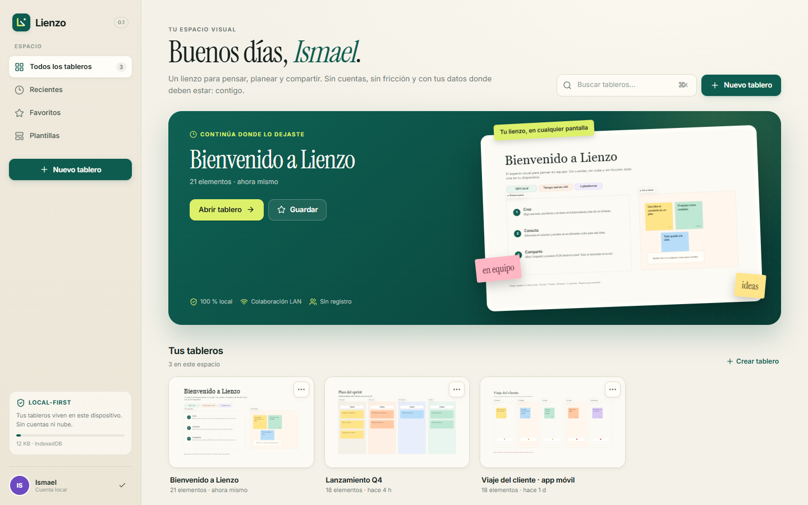
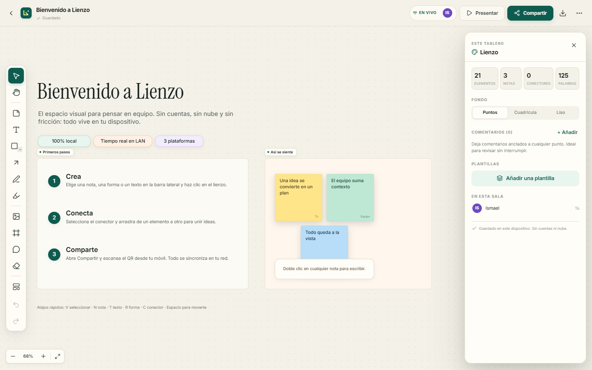
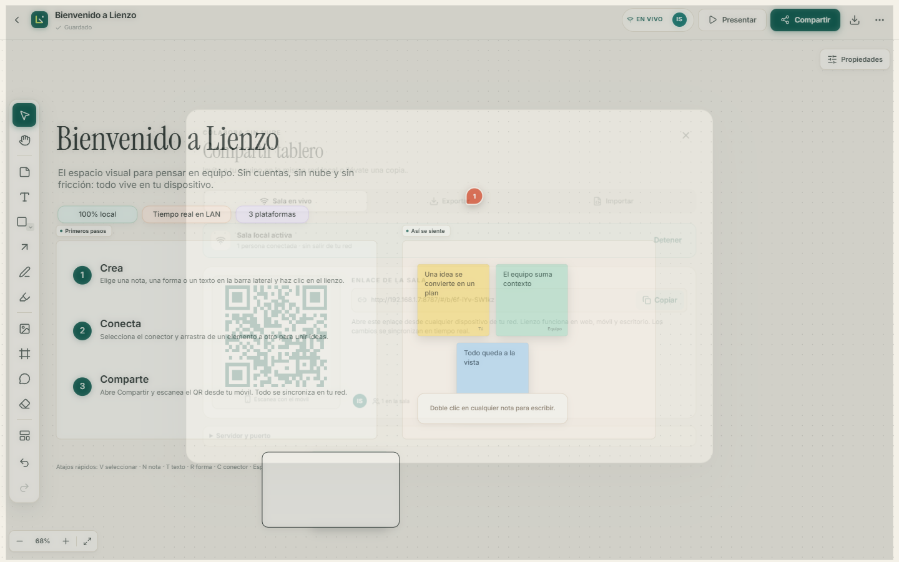
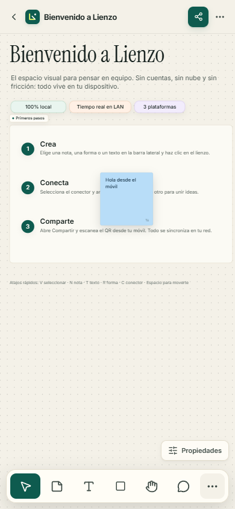
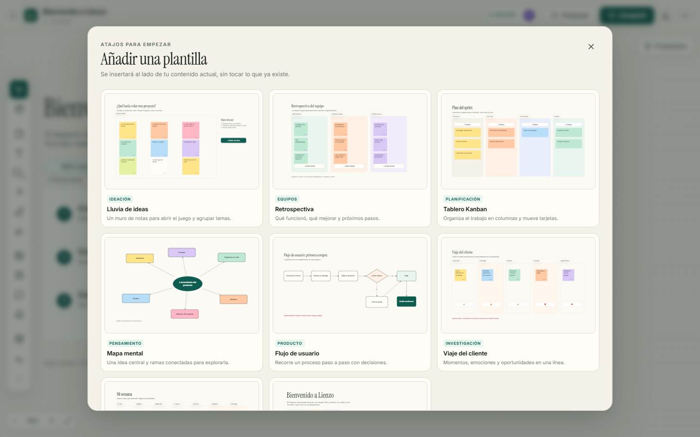
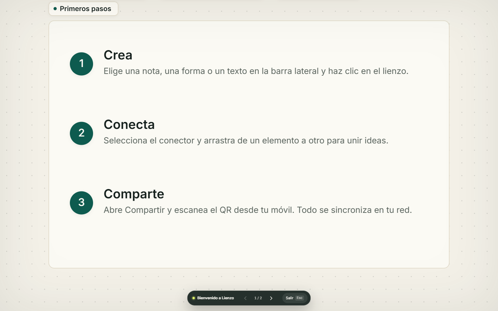

# Lienzo (alpha)

**Pizarra visual colaborativa local-first para web, escritorio y móvil.** Sin cuentas, sin nube y sin fricción: tus tableros viven en tu dispositivo y se comparten en tu red local.

Repositorio: <https://github.com/ismael567-wq/lienzo> · Releases: <https://github.com/ismael567-wq/lienzo/releases>

> **Versión alpha `0.1.0-alpha.1`.** Es una versión para probar y dar feedback, no para producción. El instalador de Windows no está firmado; SmartScreen puede pedir confirmación. Lee la [guía de uso](docs/GUIA-USO.md) y los [límites conocidos](docs/ARQUITECTURA.md#11-límites-conocidos).



Lienzo es una alternativa deliberadamente contenida a Miro: recupera el gesto de pensar en un lienzo infinito, pero elimina la dependencia de un SaaS, el registro y la facturación por asiento. Está construido desde cero con TypeScript, React y Canvas 2D.

## Lo que puedes hacer

- **Lienzo infinito** con pan, zoom, atajos y navegación táctil.
- **Notas, formas, texto, dibujo, resaltador, imágenes, marcos y conectores.**
- **Selección múltiple**, alineación, distribución, orden Z, bloqueo y duplicación.
- **Edición en línea** de notas, textos y etiquetas de formas.
- **9 plantillas** curadas: lluvia de ideas, retrospectiva, kanban, mapa mental, flujo, viaje del cliente, plan semanal y bienvenida.
- **Comentarios anclados** con resolución y lista lateral.
- **Presentación** recorriendo marcos como diapositivas.
- **Persistencia local** en IndexedDB y autosave.
- **Exportar PNG/JSON**, importar archivos `.lienzo.json`.
- **Sala en vivo por LAN**: QR, enlace, presencia, cursores y sincronización en tiempo real.
- **Web, escritorio y móvil** con la misma base de código.
- **PWA instalable** y proyectos nativos Android/iOS con Capacitor.

## Capturas

| Web / escritorio | Tablero |
|---|---|
|  |  |

| Compartir por LAN | Móvil |
|---|---|
|  |  |

| Plantillas | Presentación |
|---|---|
|  |  |

Más capturas en [`docs/screenshots/`](docs/screenshots/).

## Descargar e instalar (Windows alpha)

Los artefactos están en la sección **Releases** del repositorio:

- **Instalador**: `Lienzo-Setup-0.1.0-alpha.1.exe`
- **Portable**: `Lienzo-0.1.0-alpha.1-portable.exe`

Si Windows muestra “Windows protegió tu PC”:

1. Pulsa **Más información**.
2. Pulsa **Ejecutar de todas formas**.

Es normal: la alpha no tiene firma de código. El instalador crea accesos directos y un desinstalador; el portable no requiere instalación. Requiere Windows 10/11 de 64 bits.

También puedes generarlos desde el código:

```bash
npm run desktop:installer   # release/Lienzo-Setup-<version>.exe
npm run desktop:portable    # release/Lienzo-<version>-portable.exe
npm run desktop:dist        # release/Lienzo-<version>-win.zip
```

## Inicio rápido

### Web local

```bash
npm install
npm run build
npm run server
```

Abre <http://localhost:8787>. El mismo servidor sirve la app y la sala WebSocket. Para desarrollo con recarga:

```bash
npm run dev
# http://localhost:5173
```

### Escritorio

```bash
npm run desktop            # compila y abre Electron
npm run desktop:installer  # instalador NSIS alpha
npm run desktop:portable   # ejecutable portable
```

El servidor de sala se inicia dentro de Electron y elige automáticamente un puerto libre (8787–8799). Los artefactos de la alpha están en `release/` y en la sección **Releases** de GitHub.

> En Windows, si tu entorno define `ELECTRON_RUN_AS_NODE`, usa `npm run desktop` (el lanzador lo elimina) o desactiva esa variable antes de abrir el `.exe`.

### Móvil

**PWA (recomendado para probar ya):**

1. Arranca `npm run server` en el ordenador.
2. Abre `http://<IP-de-tu-PC>:8787` en el móvil, en la misma red.
3. Usa “Añadir a pantalla de inicio”. La app funciona offline después de la primera carga.

**Capacitor (proyecto nativo):**

```bash
npm run cap:sync
npx cap open android   # requiere Android Studio / JDK
npx cap open ios       # requiere Xcode en macOS
```

Los proyectos `android/` e `ios/` ya están generados. Para producir un APK:

```bash
cd android
gradlew.bat assembleDebug      # Windows
# ./gradlew assembleDebug      # macOS/Linux
# android/app/build/outputs/apk/debug/app-debug.apk
```

La compilación nativa no se ejecutó en este entorno porque no hay JDK/Android SDK instalados; el proyecto y los assets web sí están sincronizados.

## Colaboración en tu red

1. Abre un tablero.
2. Pulsa **Compartir**.
3. Pulsa **Iniciar sala**.
4. Escanea el QR desde el móvil o copia el enlace.

La sala se sirve desde tu equipo. Los tableros se guardan en `data/boards/` cuando usas el servidor Node, o en el directorio de usuario de Electron. No hay servidores externos.

## Atajos principales

| Acción | Atajo |
|---|---|
| Seleccionar | `V` |
| Mover lienzo | `H` o `Espacio` |
| Nota | `N` |
| Texto | `T` |
| Forma | `R` / `O` elipse / `D` rombo |
| Conector | `C` |
| Dibujar / resaltar | `P` / `L` |
| Marco | `F` |
| Comentario | `M` |
| Imagen | `I` |
| Borrar | `E` |
| Deshacer / rehacer | `Ctrl/Cmd+Z` / `Ctrl/Cmd+Shift+Z` |
| Duplicar | `Ctrl/Cmd+D` |
| Paleta de comandos | `Ctrl/Cmd+K` |
| Ajustar a todo | `Shift+1` |
| Presentar / salir | `Presentar` / `Esc` |

## Arquitectura en 30 segundos

- `src/` contiene la app React, el store Zustand, el motor Canvas 2D y la lógica de colaboración.
- `server/` es un servidor Node sin framework: estático + WebSocket + persistencia JSON.
- `electron/` arranca el servidor embebido y carga la app en una ventana.
- `android/` e `ios/` son los proyectos Capacitor.
- La persistencia es IndexedDB; la sala es opcional y usa last-write-wins por objeto.

Más detalle en [`docs/ARQUITECTURA.md`](docs/ARQUITECTURA.md).

## Documentación

- [Guía de uso](docs/GUIA-USO.md): instalar, primeros pasos, LAN, móvil y resolución de problemas.
- [Análisis de Miro](docs/ANALISIS-MIRO.md): producto, objetivos, GitHub, arquitectura pública, negocio y oportunidad.
- [Instalación de REA](docs/REA-INSTALACION.md): repo original, instalación, compilación y verificación del CLI.
- [Arquitectura](docs/ARQUITECTURA.md): modelo de datos, render, sync, plataformas y límites.
- [Verificación](docs/VERIFICACION.md): pruebas, E2E, build, Electron y capturas.
- [Changelog](CHANGELOG.md): historial de la alpha.

## Estado y límites

Este es un **MVP alpha funcional**, no un clon completo de Miro. Funciona y está probado en web, escritorio y móvil (PWA), pero no incluye nube, cuentas, permisos enterprise, las 250+ integraciones ni IA generativa. La colaboración es LWW por objeto y está pensada para equipos pequeños en la misma red.

Lista completa de límites y roadmap en [`docs/ARQUITECTURA.md#11-límites-conocidos`](docs/ARQUITECTURA.md#11-límites-conocidos).

## Stack

React 19 · TypeScript · Vite 8 · Zustand · Canvas 2D · IndexedDB · Node.js · WebSocket · Electron · Capacitor · PWA · Vitest · Playwright.

## Licencia

MIT. Consulta [`LICENSE`](LICENSE).

---

Hecho para pensar en voz alta, sin pedir permiso a la nube.
