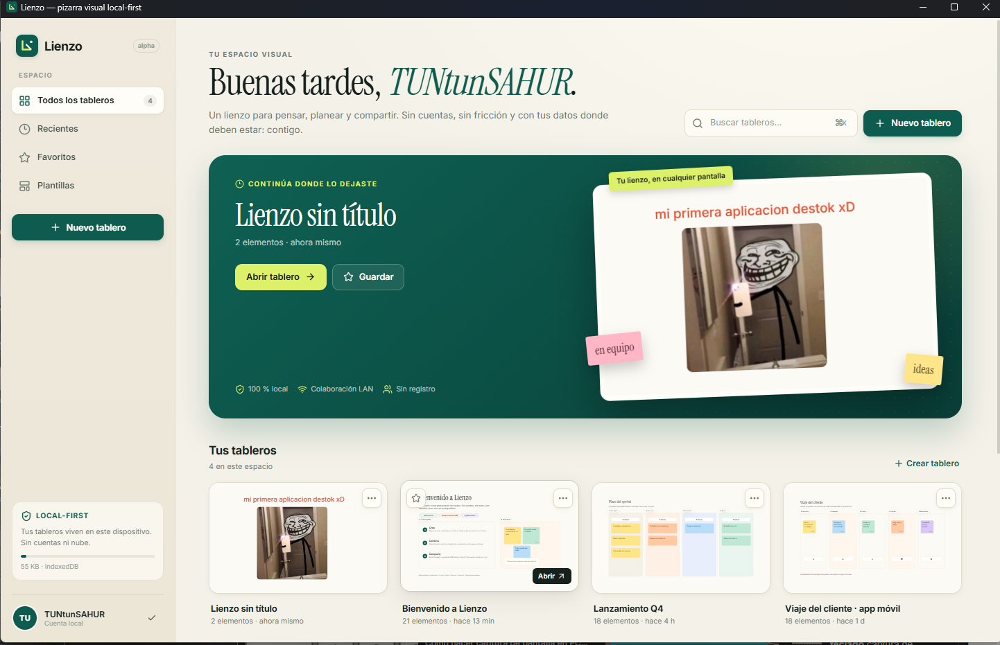
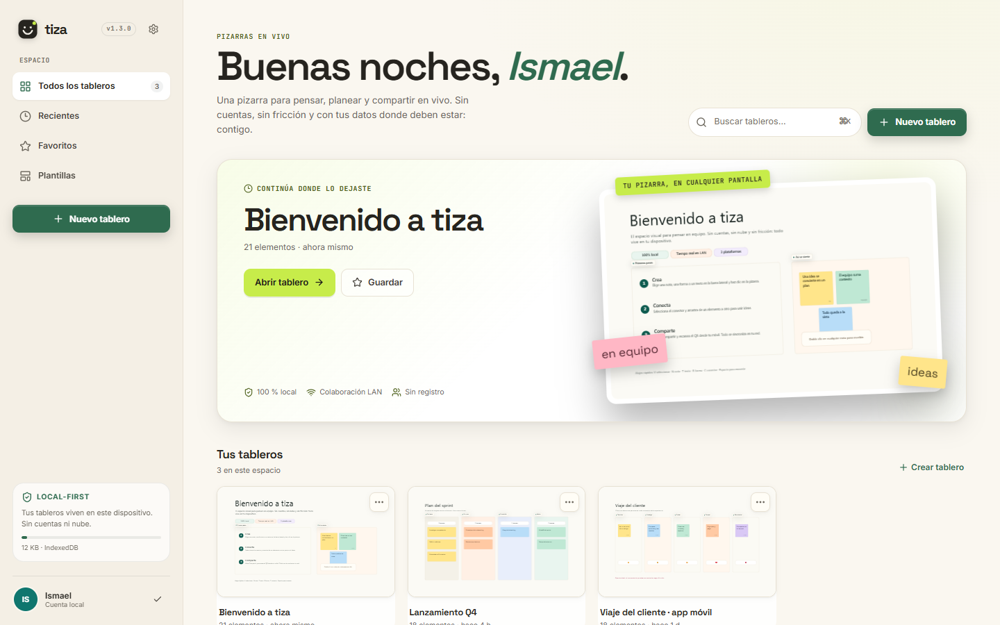
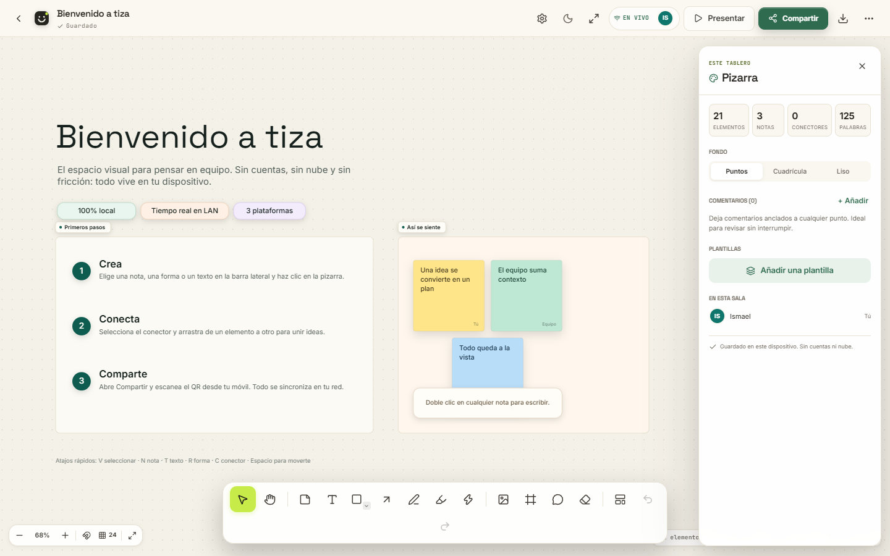

# tiza

**Pizarras en vivo.** Una pizarra visual colaborativa local-first para web, escritorio y móvil. Sin cuentas, sin nube y sin fricción: tus tableros viven en tu dispositivo y se comparten en tu red local.

Repositorio: <https://github.com/ismael567-wq/LIENZO-xD> · Releases: <https://github.com/ismael567-wq/LIENZO-xD/releases>

> **Versión `2.0.0`.** Alpha funcional para probar y dar feedback, no para producción. El instalador de Windows no está firmado; SmartScreen puede pedir confirmación. Lee la [guía de uso](docs/GUIA-USO.md) y los [límites conocidos](docs/ARQUITECTURA.md#11-límites-conocidos).



tiza es una alternativa deliberadamente contenida a Miro: recupera el gesto de pensar en un lienzo infinito, pero elimina la dependencia de un SaaS, el registro y la facturación por asiento. Está construido desde cero con TypeScript, React y Canvas 2D.

## La identidad v2

- **tiza / pizarras en vivo.** Nombre corto, descriptivo y memorable.
- **Logo de sonrisa de tiza.** Una teja clara, dos ojos y una chispa lima; funciona a 16 px y en la barra superior.
- **Noche como tema principal.** Fondo `#1E1C19`, superficies cálidas y lima para la acción. El tema día conserva la misma jerarquía.
- **Selector auto / día / noche.** `auto` sigue la preferencia del sistema; la elección se recuerda y se aplica antes del primer pintado.
- **Tipografía con carácter.** Space Grotesk para titulares, Inter para interfaz y JetBrains Mono para metadatos y atajos.
- **Diseño verificable.** 48 combinaciones de contraste WCAG AA y objetivos táctiles de 44 px en dispositivos con puntero grueso.

Más detalle en [tiza v2: rediseño y alcance](docs/TIZA-V2.md).

## Lo que puedes hacer

- **Lienzo infinito** con pan, zoom, atajos y navegación táctil.
- **Notas, formas, texto, dibujo, resaltador, imágenes, marcos y conectores.**
- **Puntero láser** efímero para señalar sin dejar trazos.
- **Tema automático, claro y oscuro** que también cambia el lienzo, no solo la interfaz.
- **Barra flotante inferior**, acciones rápidas sobre la selección y menú contextual.
- **Selección múltiple**, agrupación, alineación, distribución, orden Z, bloqueo y duplicación.
- **Búsqueda en la pizarra** con `Ctrl/Cmd+F` y salto al elemento encontrado.
- **Historial de versiones** local, instantáneas automáticas y restauración con deshacer.
- **Temporizador de foco** de 15, 25 o 50 minutos para sesiones sin distracciones.
- **Bloqueo de pizarra** para revisar o presentar sin editar por accidente.
- **Estilos de relleno y borde** (sólido, rayado, cruzado, puntos) y conectores rectos, en codo o curva.
- **Edición en línea** de notas, textos y etiquetas de formas, con tipografías sans, serif y mono.
- **9 plantillas** curadas: bienvenida, lluvia de ideas, retrospectiva, kanban, mapa mental, flujo, viaje del cliente, plan semanal y pizarra en blanco.
- **Comentarios anclados** con resolución y lista lateral.
- **Presentación** recorriendo marcos como diapositivas y **modo concentración** sin paneles.
- **Persistencia local** en IndexedDB y autosave.
- **Exportar PNG/JSON**, PNG de la selección, copia al portapapeles, fondo transparente e importar archivos `.tiza.json`.
- **Sala en vivo por LAN**: QR, enlace, presencia, cursores y sincronización en tiempo real.
- **Web, escritorio y móvil** con la misma base de código.
- **PWA instalable** y proyectos nativos Android/iOS con Capacitor.

## Capturas

| Web / escritorio | Tablero |
|---|---|
|  |  |

| Compartir por LAN | Móvil |
|---|---|
|  |  |

| Plantillas | Presentación |
|---|---|
|  |  |

| Tema día · dashboard | Tema día · pizarra |
|---|---|
|  |  |

Más capturas en [`docs/screenshots/`](docs/screenshots/).

## Inicio rápido

### Web local

```bash
npm install
npm run build
npm run server
```

Abre <http://localhost:8787>. El mismo servidor sirve la app y la sala WebSocket. Para desarrollo con recarga:

```bash
npm run dev
# http://localhost:5173
```

### Escritorio

```bash
npm run desktop            # compila y abre Electron
npm run desktop:installer  # instalador NSIS alpha
npm run desktop:portable   # ejecutable portable
```

El servidor de sala se inicia dentro de Electron y elige automáticamente un puerto libre (8787–8799). Los artefactos se generan en `release/`.

> En Windows, si tu entorno define `ELECTRON_RUN_AS_NODE`, usa `npm run desktop` (el lanzador lo elimina) o desactiva esa variable antes de abrir el `.exe`.

### Móvil

**PWA (recomendado para probar ya):**

1. Arranca `npm run server` en el ordenador.
2. Abre `http://<IP-de-tu-PC>:8787` en el móvil, en la misma red.
3. Usa «Añadir a pantalla de inicio». La app funciona offline después de la primera carga.

**Capacitor (proyecto nativo):**

```bash
npm run cap:sync
npx cap open android   # requiere Android Studio / JDK
npx cap open ios       # requiere Xcode en macOS
```

Los proyectos `android/` e `ios/` ya están generados. Para producir un APK:

```bash
cd android
gradlew.bat assembleDebug      # Windows
# ./gradlew assembleDebug      # macOS/Linux
# android/app/build/outputs/apk/debug/app-debug.apk
```

La compilación nativa no se ejecutó en este entorno porque no hay JDK/Android SDK instalados; el proyecto y los assets web sí están sincronizados.

## Colaboración en tu red

1. Abre un tablero.
2. Pulsa **Compartir**.
3. Pulsa **Iniciar sala**.
4. Escanea el QR desde el móvil o copia el enlace.

La sala se sirve desde tu equipo. Los tableros se guardan en `data/boards/` cuando usas el servidor Node, o en el directorio de usuario de Electron. No hay servidores externos.

## Atajos principales

| Acción | Atajo |
|---|---|
| Seleccionar | `V` |
| Mover lienzo | `H` o `Espacio` |
| Nota | `N` |
| Texto | `T` |
| Forma | `R` / `O` elipse / `D` rombo |
| Conector | `C` |
| Dibujar / resaltar | `P` / `L` |
| Puntero láser | `K` |
| Marco | `F` |
| Comentario | `M` |
| Imagen | `I` |
| Borrar | `E` |
| Ajuste a cuadrícula | `G` |
| Buscar en la pizarra | `Ctrl/Cmd+F` |
| Deshacer / rehacer | `Ctrl/Cmd+Z` / `Ctrl/Cmd+Shift+Z` |
| Duplicar | `Ctrl/Cmd+D` |
| Agrupar / desagrupar | `Ctrl/Cmd+G` / `Ctrl/Cmd+Shift+G` |
| Paleta de comandos | `Ctrl/Cmd+K` |
| Ajustar a todo | `Shift+1` |
| Presentar / salir | `Presentar` / `Esc` |
| Salir de concentración | `Esc` |

## Arquitectura en 30 segundos

- `src/` contiene la app React, el store Zustand, el motor Canvas 2D y la lógica de colaboración.
- `server/` es un servidor Node sin framework: estático + WebSocket + persistencia JSON.
- `electron/` arranca el servidor embebido y carga la app en una ventana.
- `android/` e `ios/` son los proyectos Capacitor.
- La persistencia es IndexedDB; la sala es opcional y usa last-write-wins por objeto.
- Las versiones del historial viven en IndexedDB y se podan a 24 por pizarra.

Más detalle en [`docs/ARQUITECTURA.md`](docs/ARQUITECTURA.md).

## Verificación

```bash
npm run typecheck
npm test
npm run build
npm run contraste
```

- TypeScript sin errores.
- 33 pruebas unitarias aprobadas.
- Build de Vite + PWA correcto.
- Auditoría de contraste: 48/48 combinaciones WCAG AA.
- QA visual en navegador real a 1440×900 y 390×844, sin errores de consola.

Resultados y comandos en [`docs/VERIFICACION.md`](docs/VERIFICACION.md).

## Documentación

- [Guía de uso](docs/GUIA-USO.md): instalar, primeros pasos, LAN, móvil y resolución de problemas.
- [tiza v2](docs/TIZA-V2.md): identidad, sistema visual, funciones nuevas y alcance pendiente.
- [Arquitectura](docs/ARQUITECTURA.md): modelo de datos, render, sync, plataformas y límites.
- [Verificación](docs/VERIFICACION.md): pruebas, E2E, build, contraste y capturas.
- [Changelog](CHANGELOG.md): historial de versiones.
- [Análisis de Miro](docs/ANALISIS-MIRO.md): producto, objetivos y oportunidad.
- [Análisis de Excalidraw](docs/EXCALIDRAW-ANALISIS.md): patrones de interfaz, modelo de datos y render.
- [Instalación de REA](docs/REA-INSTALACION.md): repo original, instalación y verificación del CLI.

## Estado y límites

Este es un **MVP alpha funcional**, no un clon completo de Miro. Funciona y está probado en web, escritorio y móvil (PWA), pero no incluye nube, cuentas, permisos enterprise ni las 250+ integraciones. La IA es opcional y local/BYOK. La colaboración es LWW por objeto y está pensada para equipos pequeños en la misma red.

Las familias v1.3 (13/13), v1.4 (42/42) y v2.0 (31/31) están completas. De v2.0+ se entregan MCP, plugins y Make Real; falta la asociación `.tiza` con el sistema operativo. El detalle y los límites honestos están en [`docs/TIZA-V2.md`](docs/TIZA-V2.md#8-lo-que-queda-pendiente).

Lista completa de límites en [`docs/ARQUITECTURA.md#11-límites-conocidos`](docs/ARQUITECTURA.md#11-límites-conocidos).

## Stack

React 19 · TypeScript · Vite 8 · Zustand · Canvas 2D · IndexedDB · Node.js · WebSocket · Electron · Capacitor · PWA · Vitest · Playwright.

## Licencia

MIT. Consulta [`LICENSE`](LICENSE).

---

Hecho para pensar en voz alta, sin pedir permiso a la nube.
