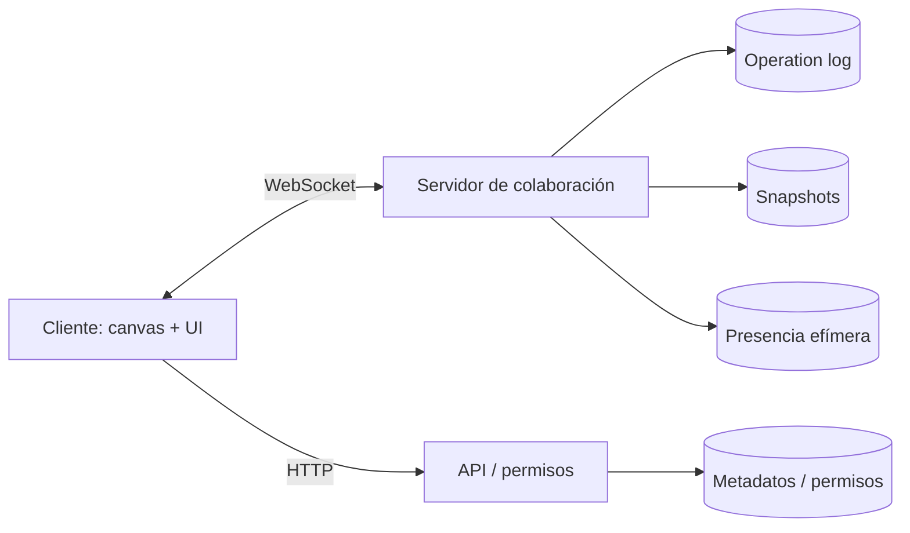

# Miro: análisis de producto, ecosistema y oportunidad

> **Alcance.** Análisis de producto y ecosistema basado en fuentes públicas: web de Miro, precios, documentación para desarrolladores, organización de GitHub y prensa. El núcleo de Miro es un SaaS cerrado: no se dispone del código de su motor colaborativo, por lo que la sección técnica es un análisis de la arquitectura **descrita públicamente** y de las decisiones observables, no una auditoría de su implementación.
>
> **Fecha de análisis:** noviembre de 2026.

---

## 1. Resumen ejecutivo

- Miro nació en 2011 como **RealtimeBoard**, un tablero colaborativo en tiempo real, y se rebautizó como Miro en marzo de 2019. [Fuente](https://miro.com/blog/features/realtimeboard-is-now-miro/)
- Hoy se posiciona como un **“AI innovation workspace”**: un lienzo visual compartido donde confluyen pizarras, diagramas, planificación, prototipos, documentos, slides y flujos de IA. [Fuente](https://miro.com/features/)
- Su propuesta de valor no es “dibujar”: es **reducir el cambio de herramienta** y alinear a equipos multidisciplinares alrededor de un espacio visual común.
- Escala declarada: **100M+ usuarios**, **250.000+ organizaciones**, **4M+ usuarios de pago** y unos **600 M USD de ARR** (90 % enterprise). En 2026 se anunció su venta a Bending Spoons por 1.360 M USD. [Yahoo Finance](https://finance.yahoo.com/technology/articles/bending-spoons-buy-collaboration-tools-143409457.html)
- Sus cuatro palancas de producto son: **lienzo infinito**, **plantillas**, **integraciones** (250+) y **IA/MCP**. [Fuente](https://miro.com/features/)
- La organización de GitHub (`miroapp`) tiene **46 repositorios públicos** y está centrada en el ecosistema: clientes de API, ejemplos de apps, Web SDK, herramientas de IA/MCP, plugins y utilidades. **El producto principal no es open source.**
- La colaboración se apoya en un modelo de objetos independientes, sincronización por operaciones, presencia separada del estado durable, resolución de conflictos por campo y renderizado selectivo por viewport. [Análisis técnico de referencia](https://www.educative.io/blog/miro-system-design)
- El negocio es **freemium por asiento**: gratis con 3 tableros; Starter 8 USD/mes; Business 20 USD/mes; Enterprise a medida. [Precios](https://miro.com/pricing/)
- Las fricciones son claras: dependencia de nube y cuenta, coste por asiento, curva de aprendizaje, exceso de funciones y sensibilidad a la privacidad.
- **Lienzo** explora el hueco contrario: local-first, sin registro, offline, colaboración en LAN, API abierta y una experiencia deliberadamente contenida.

---

## 2. Qué es Miro y qué problema resuelve

Miro es una **pizarra visual colaborativa** en la que varias personas trabajan a la vez sobre un lienzo 2D prácticamente infinito. Su unidad no es la página ni la diapositiva, sino el **objeto**: una nota, una forma, un texto, un conector, una imagen, un marco o un documento.

El problema que resuelve es el de la **coordinación visual**: cuando un equipo necesita pensar, planificar o decidir algo que no cabe en una lista o en un documento lineal. Reuniones, workshops, mapas de cliente, arquitecturas, roadmaps, lluvia de ideas, retrospectivas, wireframes y presentaciones comparten una necesidad: ver relaciones y mantener el contexto.

Miro añade a eso tres capas:

1. **Colaboración en tiempo real** con cursores, selección y edición concurrente.
2. **Contenido reutilizable** mediante plantillas y frameworks.
3. **Conexión con el resto del stack** mediante apps, APIs, Web SDK, embeds e IA.

La empresa se describe a sí misma como una plataforma de innovación basada en IA para equipos, no solo como una pizarra. [Home](https://miro.com/)

---

## 3. Objetivos estratégicos

| Objetivo | Cómo se refleja en el producto |
|---|---|
| Ser el lugar donde empieza el trabajo | Lienzo como primera pantalla, plantillas para cada workflow y “blueprints”. |
| Eliminar el cambio de herramienta | 250+ integraciones, embeds, MCP, importación/exportación. |
| Convertir la colaboración en resultados | Votaciones, temporizador, estimaciones, presentaciones, Talktrack, resúmenes con IA. |
| Atender a empresas | SSO/SAML, SCIM, auditoría, residencia de datos, roles, Enterprise Guard. |
| Crecer por ecosistema | API REST, Web SDK, app marketplace, ejemplos y herramientas para desarrolladores. |
| Monetizar por asiento | Planes Free/Starter/Business/Enterprise con límites de tableros y créditos de IA. |
| Incorporar IA de forma transversal | Generación de diagramas, síntesis, workflows, agentes y conexión MCP. |

La venta anunciada a Bending Spoons refuerza la lectura financiera: Miro es un negocio maduro, con una base enterprise muy grande, y el siguiente capítulo se orienta a eficiencia y expansión de IA más que a crecimiento explosivo.

---

## 4. Mapa funcional

### 4.1 Lienzo y navegación

- Lienzo infinito con pan y zoom.
- Marcos (“frames”) que actúan como secciones y como diapositivas en presentaciones.
- Capas, agrupación, alineación, bloqueo y orden Z.
- Minimapa, búsqueda y navegación por secciones.

### 4.2 Objetos y contenido

- Notas adhesivas, formas, texto, conectores, dibujo, imágenes, iconos y stickers.
- Diagramas, wireframes, tablas, cronologías, kanban y documentos dentro del lienzo.
- Prototipos interactivos y librerías de componentes.
- Importación desde Visio, Lucidchart, Sketch, Jira, Asana y otras fuentes.
- 6.000–7.000+ plantillas según la página consultada. [Features](https://miro.com/features/)

### 4.3 Colaboración

- Multijugador en tiempo real con cursores y selección.
- Comentarios anclados, menciones y notificaciones.
- Votación, temporizador, estimaciones y controles de facilitación.
- Talktrack: recorridos de vídeo grabados sobre el tablero para colaboración asíncrona.
- Presentaciones que recorren marcos manteniendo el acceso al tablero.
- Videollamada integrada y “engage activities”.

### 4.4 IA y automatización

- Generación de diagramas, tablas y resúmenes a partir de contenido del tablero.
- “Flows” y agentes para automatizar procesos de varios pasos.
- MCP para conectar Claude, Cursor, Copilot, Gemini CLI y otros agentes con los tableros. [Miro MCP](https://developers.miro.com/docs/miro-mcp)
- Créditos de IA por plan y controles de gobierno para empresas.

### 4.5 Plataforma y empresa

- API REST, Web SDK, Live Embed y app marketplace.
- SSO/SAML, SCIM, auditoría, roles, residencia de datos (EU/US/AU/JP).
- Certificaciones ISO 27001, SOC 2, SOC 3, NIST, TISAX y cumplimiento GDPR.
- Enterprise Guard para clasificación, retención y eDiscovery.

---

## 5. Cómo se organiza la experiencia

Miro sigue un patrón de **tres niveles**:

1. **Dashboard**: tableros, espacios, plantillas, búsqueda y acceso a la cuenta.
2. **Tablero**: lienzo a pantalla completa con barras flotantes, paneles contextuales y presencia.
3. **Objeto**: selección, inspector de estilo, menú contextual y edición en línea.

La interfaz evita modos complejos: la barra de herramientas es persistente y las acciones frecuentes (nota, forma, texto, conector) están a un clic. Los paneles laterales aparecen solo cuando hacen falta. La colaboración se hace visible en la parte superior con avatares y cursores en el lienzo.

La presentación es una **vista del mismo tablero**, no un formato separado: los marcos se convierten en diapositivas y se puede salir de la presentación para explorar el contexto. Esa continuidad es una decisión de producto importante: reduce la duplicación entre “pensar” y “presentar”.

---

## 6. Ecosistema y organización de GitHub

### 6.1 Qué hay en `miroapp`

La organización tiene **46 repositorios públicos**. Los más relevantes para entender la estrategia:

| Repositorio / familia | Qué revela |
|---|---|
| `api-clients` | Clientes oficiales de la API REST (Python, TypeScript/Node, Java). La API es un producto de primera clase. |
| `app-examples` | Ejemplos de apps para la plataforma, Web SDK, Live Embed y marketplace. |
| `miro-ai` | Herramientas de IA para desarrolladores, configuración MCP y skills para agentes. |
| `sketch_plugin` | Importación desde Sketch; integración con herramientas de diseño. |
| `quill` | Fork mantenido de un editor WYSIWYG; inversión en edición de texto enriquecido. |
| `ts-scope-trimmer-plugin` | Utilidad interna de TypeScript publicada como open source. |
| Terraform / taps / utilidades | Infraestructura, integraciones de datos y herramientas internas. |

La organización es, en la práctica, la **capa de extensibilidad** de Miro: SDKs, ejemplos, conectores, herramientas de IA y utilidades. No contiene el motor de colaboración, el renderizador del lienzo ni la aplicación principal.

### 6.2 Lectura estratégica

- **Producto cerrado, plataforma abierta.** Miro abre los bordes (API, SDK, marketplace) para que el valor se construya alrededor del lienzo, pero conserva el núcleo.
- **El desarrollador es un canal de distribución.** Las apps publicadas en el marketplace amplían casos de uso sin que Miro tenga que construirlos todos.
- **IA como interfaz.** `miro-ai` y MCP convierten el tablero en contexto para agentes: el lienzo pasa de destino a fuente de contexto.
- **Integraciones como foso.** Jira, Asana, Slack, Teams, Figma, Notion, Azure DevOps y 250+ apps hacen costoso abandonar el ecosistema.

Para una alternativa open source, la lección no es copiar 250 integraciones, sino **diseñar una arquitectura extensible** y empezar por el núcleo que el usuario puede controlar.

---

## 7. Arquitectura técnica: lo que se puede inferir

> Esta sección combina documentación pública, comportamiento observable y literatura técnica. No pretende describir con exactitud la implementación propietaria.

Un tablero tipo Miro se puede descomponer en:

### 7.1 Modelo de datos

- El tablero es una **colección de objetos independientes** con id, tipo, geometría, estilo y contenido.
- Las referencias entre objetos (conectores, marcos) forman un grafo disperso sobre el plano.
- Cada objeto tiene versión/metadatos para resolver concurrencia.

### 7.2 Sincronización

- Las ediciones viajan como **operaciones pequeñas** (crear, mover, cambiar estilo, borrar), no como el tablero completo.
- La presencia (cursor, selección) va por un canal efímero separado y sin persistencia.
- La resolución de conflictos se hace por **campo** y, en el caso general, con última escritura gana; el texto puede requerir CRDT/OT.
- Los clientes aplican cambios de forma optimista y el servidor ordena y difunde.

### 7.3 Escalado

- Indexación espacial (quadtree/R-tree) y virtualización por viewport para no renderizar objetos fuera de pantalla.
- Snapshots periódicos + operation log para historial y recuperación.
- Separación de planos: estado durable, presencia, permisos y metadata.

### 7.4 Renderizado

- Canvas 2D/WebGL en lugar de DOM para soportar miles de objetos.
- Objetivo de 60 fps, degradación a 30 fps en tableros densos.
- Capas: fondo, objetos, conectores, selección, cursores, UI.

Lienzo adopta una versión **deliberadamente simple y local-first** de estas ideas: objetos independientes, operaciones por ítem, presencia separada y Canvas 2D con culling. No implementa CRDT ni un clúster; prioriza que un equipo pequeño pueda trabajar sin infraestructura.

---

## 8. Modelo de negocio

| Plan | Precio | Límites principales |
|---|---|---|
| Free | 0 USD | 3 tableros editables, miembros ilimitados, IA limitada, sin roles de visitor/guest. |
| Starter | 8 USD/mes por miembro (anual) | Tableros ilimitados, privacidad, plantillas, 25 créditos IA/mes. |
| Business | 20 USD/mes por miembro (anual) | Suite de IA, integraciones profundas, SSO, prototipos, planificación. |
| Enterprise | A medida (desde 30 miembros) | Seguridad, gobierno, residencia de datos, SCIM, auditoría, Enterprise Guard. |

[Precios oficiales](https://miro.com/pricing/)

El modelo es **per-seat** y está orientado a expansión dentro de la organización: cuanto más se usa el tablero como espacio de coordinación, más asientos y más necesidades enterprise. La IA se monetiza con créditos, lo que añade una palanca de uso.

---

## 9. Fricciones y espacio para una alternativa

### Fricciones observables

- **Dependencia de la nube**: sin conexión no hay tablero; los datos viven en un servicio externo.
- **Cuenta y onboarding**: invitar, permisos y gestión de equipos añaden fricción para uso personal o talleres puntuales.
- **Coste por asiento**: un equipo grande paga por cada miembro, aunque solo edite ocasionalmente.
- **Complejidad**: la amplitud de funciones (IA, apps, prototipos, planning) puede abrumar a quien solo quiere una pizarra.
- **Privacidad y soberanía**: aunque hay residencia de datos, el modelo sigue siendo centralizado.
- **Vendor lock-in**: exportar es posible, pero la experiencia completa vive dentro de Miro.

### Hueco para Lienzo

Lienzo no intenta ganar a Miro en amplitud. Elige un segmento distinto:

- **Local-first**: el tablero vive en el dispositivo; funciona sin internet.
- **Sin cuentas**: abrir y empezar.
- **Colaboración LAN**: un servidor pequeño en la red local, con QR, sin nube.
- **Multiplataforma real**: una base de código para web, escritorio y móvil.
- **Datos abiertos**: JSON editable, exportación PNG, importación.
- **Precio cero**: sin créditos, sin asientos, sin límites artificiales.

Es una propuesta **complementaria** a Miro, no un clon a escala enterprise.

---

## 10. Decisiones de producto para Lienzo

| Decisión de Miro | Decisión en Lienzo | Razón |
|---|---|---|
| Lienzo infinito | Igual | Es el corazón del modelo mental. |
| Objetos independientes | Igual | Permite edición granular y extensibilidad. |
| Multijugador en la nube | WebSocket en LAN + modo local | Privacidad y cero infraestructura. |
| Presencia separada | Igual | Cursores no deben bloquear la persistencia. |
| Plantillas | 9 plantillas curadas | Valor sin catálogo infinito. |
| Frames como diapositivas | Igual | Continuidad entre pensar y presentar. |
| Comentarios | Pines + panel | Revisión ligera sin interrumpir. |
| Inspector contextual | Igual | La UI no debe ocupar el lienzo. |
| 250 integraciones | Exportación JSON/PNG e importación | Empezar por lo esencial y abrir después. |
| IA/MCP | Roadmap | Requiere consentimiento y proveedor; no es el núcleo del MVP. |
| Enterprise/SSO | Fuera de alcance | Segmento distinto. |

---

## 11. Matriz de paridad de Lienzo

| Capacidad | Estado | Nota |
|---|---|---|
| Lienzo infinito, pan, zoom | ✅ | Canvas 2D con DPR y atajos. |
| Notas, formas, texto, dibujo | ✅ | Edición en línea y estilos. |
| Conectores | ✅ | Anclados a objetos o puntos libres. |
| Marcos y presentación | ✅ | Frames como diapositivas. |
| Imágenes | ✅ | Pegar, arrastrar o elegir archivo; compresión local. |
| Selección múltiple, alinear, distribuir | ✅ | Inspector contextual. |
| Comentarios | ✅ | Pines, resolución y lista. |
| Plantillas | ✅ | 9 plantillas + bienvenida. |
| Persistencia local | ✅ | IndexedDB, autosave. |
| Exportar PNG/JSON, importar | ✅ | Todo en el cliente. |
| Colaboración en tiempo real | ✅ | LAN con WebSocket, presencia y cursores. |
| Web local | ✅ | Vite + servidor Node. |
| Escritorio | ✅ | Electron con servidor integrado. |
| Móvil | ✅ | PWA instalable + proyectos Capacitor Android/iOS. |
| Nube / cuentas / equipos | ❌ | Decisión de alcance. |
| Permisos finos / SSO / auditoría | ❌ | Fuera del MVP. |
| 250+ integraciones | ❌ | Roadmap. |
| IA generativa / MCP | ❌ | Roadmap. |
| Talktrack / vídeo / votación | ❌ | Roadmap. |
| CRDT / multirregión | ❌ | LWW por objeto; suficiente para LAN. |

---

## 12. Conclusión

Miro demuestra que el lienzo visual es una categoría duradera, pero su escala le empuja hacia la plataforma enterprise, la IA y el ecosistema. Ese movimiento deja un espacio claro para una herramienta **más pequeña, más privada y más directa**.

Lienzo no compite en número de funciones: compite en **propiedad, simplicidad y ubicuidad**. La apuesta es que muchas personas y equipos pequeños prefieren un tablero que se abre al instante, funciona sin conexión y se comparte en la red local antes que un workspace corporativo con 250 integraciones.

---

## 13. Fuentes

- Miro — funciones: <https://miro.com/features/>
- Miro — precios: <https://miro.com/pricing/>
- Miro — historia y rebranding: <https://miro.com/blog/features/realtimeboard-is-now-miro/>
- Miro — página principal: <https://miro.com/>
- Yahoo Finance — adquisición por Bending Spoons y métricas: <https://finance.yahoo.com/technology/articles/bending-spoons-buy-collaboration-tools-143409457.html>
- GitHub `miroapp`: <https://github.com/miroapp>
- Miro Developer Platform: <https://developers.miro.com/docs>
- Miro MCP: <https://developers.miro.com/docs/miro-mcp>
- Análisis técnico de sistemas tipo Miro (fuente secundaria): <https://www.educative.io/blog/miro-system-design>
