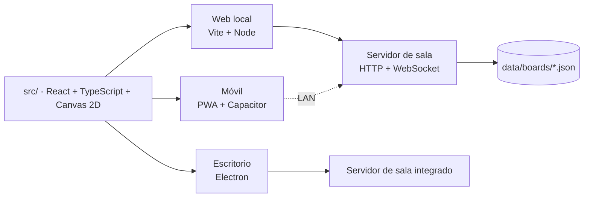
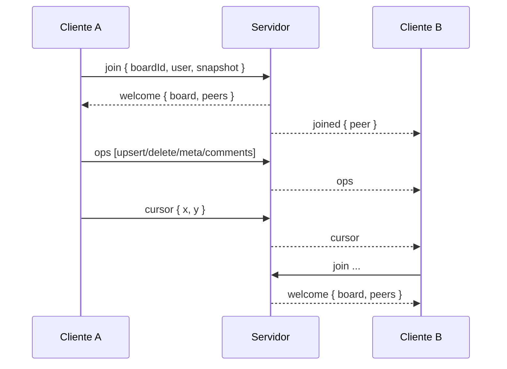

# Arquitectura de tiza

> Documento técnico del prototipo funcional. Explica las decisiones, los límites y cómo extenderlo.

## 1. Visión

tiza es una **pizarra visual local-first** con una sola base de código TypeScript/React para tres destinos:



Principios:

1. **Local-first**: el tablero se guarda en el dispositivo (IndexedDB) y funciona sin conexión.
2. **Una sola UI**: el mismo código se adapta a escritorio y móvil.
3. **Colaboración opcional**: la sala LAN es una capa, no un requisito.
4. **Datos abiertos**: JSON legible, exportación PNG y importación.
5. **Cero cuentas**: el usuario no necesita registrarse.

---

## 2. Stack

| Capa | Tecnología | Motivo |
|---|---|---|
| UI | React 19 + TypeScript | Componentes, estado predecible y tipado. |
| Bundler | Vite 8 | Desarrollo rápido y build optimizado. |
| Estado | Zustand 5 | Store pequeño, selectores granulares y fácil de testear. |
| Render | Canvas 2D | Miles de objetos sin la sobrecarga del DOM. |
| Persistencia | IndexedDB (`idb-keyval`) | Datos estructurados, imágenes y offline. |
| Iconos | Lucide | Set consistente y ligero. |
| Tipografía | Space Grotesk + Inter + JetBrains Mono | Titulares, interfaz y metadatos; fuentes locales y offline. |
| Servidor | Node.js + `ws` | HTTP estático, API y WebSocket sin framework. |
| Escritorio | Electron + electron-builder | Empaquetado Windows sin depender de toolchain nativo. |
| Móvil | PWA + Capacitor 8 | Instalación desde navegador y proyectos Android/iOS. |
| Pruebas | Vitest + Playwright | Lógica pura y flujos reales en navegador. |

---

## 3. Estructura del proyecto

```text
tiza/
├─ src/
│  ├─ components/
│  │  ├─ BoardView.tsx        # Layout del tablero, atajos, overlays
│  │  ├─ CanvasStage.tsx      # Interacción pointer + render
│  │  ├─ TopBar.tsx           # Título, presencia, exportar, menús
│  │  ├─ Toolbar.tsx          # Barra escritorio + dock móvil
│  │  ├─ Inspector.tsx        # Estilos, comentarios, stats
│  │  ├─ TextEditor.tsx       # Edición in situ
│  │  ├─ BoardPreview.tsx     # Miniaturas reales con Canvas
│  │  ├─ Dashboard.tsx        # Biblioteca de tableros
│  │  ├─ ShareDialog.tsx      # QR, sala LAN, exportar, importar
│  │  ├─ BoardSearch.tsx      # Búsqueda Ctrl/Cmd+F
│  │  ├─ HistoryDialog.tsx    # Instantáneas y restauración
│  │  ├─ FocusTimer.tsx       # Temporizador de foco
│  │  ├─ Logo.tsx             # Identidad de tiza
│  │  └─ dialogs.tsx          # Plantillas, atajos, command palette, about
│  ├─ lib/
│  │  ├─ geometry.ts          # Hit testing, bounds, conectores, zoom
│  │  ├─ canvasRenderer.ts    # Dibujo de todos los tipos de objeto
│  │  ├─ collab.ts            # Cliente WebSocket y diff de operaciones
│  │  ├─ templates.ts         # 9 tableros iniciales
│  │  ├─ factory.ts           # Creación y duplicación de objetos
│  │  ├─ storage.ts           # IndexedDB, import/export JSON
│  │  ├─ persistence.ts       # Autosave con debounce
│  │  ├─ versions.ts          # Historial local de instantáneas
│  │  ├─ net.ts               # URLs de sala, QR, portapapeles
│  │  ├─ export.ts            # PNG, JSON, compresión de imágenes
│  │  └─ theme.ts             # Paletas, tema auto/día/noche y tipografía
│  ├─ store/boardStore.ts     # Estado, historial, acciones, sync
│  └─ styles/global.css       # Tokens duales + capa de acabado v2
├─ server/
│  ├─ collab.mjs              # HTTP + WebSocket + persistencia
│  └─ index.mjs               # Arranque del servidor local
├─ electron/
│  ├─ main.cjs                # Ventana + servidor embebido
│  └─ preload.cjs             # Puente seguro de información de sala
├─ android/ · ios/            # Proyectos nativos de Capacitor
├─ tests/                     # Vitest
├─ scripts/                   # Screenshots, E2E, iconos, lanzador desktop
├─ docs/                      # Análisis, arquitectura, capturas
└─ release/                   # Artefacto de escritorio
```

---

## 4. Modelo de datos

Un tablero es un documento JSON:

```ts
interface Board {
  id: string;
  name: string;
  createdAt: number;
  updatedAt: number;
  background: 'dots' | 'grid' | 'plain';
  items: BoardItem[];
  comments: CommentPin[];
  favorite?: boolean;
  locked?: boolean;
}
```

Tipos de objeto:

| Tipo | Campos propios |
|---|---|
| `sticky` | texto, color, color de texto, tamaño de fuente, autor |
| `shape` | forma (`rect`/`ellipse`/`diamond`), texto, relleno, borde, radio |
| `text` | texto, tamaño, color, peso, familia, alineación |
| `draw` | puntos relativos, color, grosor, modo resaltador |
| `image` | data URL comprimida, dimensiones, radio |
| `frame` | título, color de fondo |
| `connector` | anclas (`itemId` o punto libre), flechas, dashed, label |

El orden del array es el orden Z. Los marcos se renderizan primero para que su contenido quede encima. Los conectores se resuelven contra las aristas de los objetos y siguen sus movimientos.

### Historial

- Snapshot completo de `items`, `comments`, `name` y `background`.
- Máximo 60 pasos.
- Los gestos (arrastrar, redimensionar) capturan el snapshot **antes** del primer cambio.
- La edición de texto guarda el estado al entrar; los cambios se aplican en vivo.
- Deshacer/rehacer no incluye selección, viewport ni estado de UI.

### Historial de versiones

- `versions.ts` guarda instantáneas completas en IndexedDB, separadas del historial de deshacer.
- Se crea una instantánea automática cada pocos minutos y se conservan las 24 más recientes por pizarra.
- El guardado manual usa `force` para no depender del intervalo.
- Restaurar una versión pasa por el historial normal, así que se puede deshacer con `Ctrl+Z`.

---

## 5. Renderizado

`canvasRenderer.ts` dibuja en este orden:

1. Fondo (papel, puntos o cuadrícula).
2. Marcos.
3. Objetos (notas, formas, texto, dibujo, imágenes, conectores).
4. Guías de alineación.
5. Comentarios (en export/preview).
6. Marquee.
7. Selección y handles.

Decisiones:

- **DPR**: el canvas se dimensiona a `devicePixelRatio` (máx. 2) para nitidez.
- **Culling implícito**: se dibuja todo el tablero; con los tamaños de un equipo pequeño es suficiente. El siguiente paso es indexar y filtrar por viewport.
- **Grid optimizado**: los puntos se dibujan en un único path para evitar miles de `fill()`.
- **Imágenes**: caché en memoria y redibujado al cargar.
- **Fuentes**: se espera a `document.fonts.ready` para evitar el “flash” de fuente.
- **Preview**: el mismo renderer genera las miniaturas reales del dashboard y la exportación PNG, con sombras reducidas.

### Interacción

`CanvasStage` implementa una máquina de gestos:

```text
idle
 ├─ pan        (mano, espacio, botón central, fondo táctil)
 ├─ move       (arrastrar selección; incluye hijos de un marco)
 ├─ resize     (8 handles)
 ├─ marquee    (ratón en vacío)
 ├─ create     (nota / forma / marco)
 ├─ draw       (lápiz / resaltador)
 ├─ connector  (arrastre entre objetos)
 ├─ erase      (borrado continuo)
 └─ pinch      (dos punteros)
```

- Espacio + arrastre = pan.
- Rueda = pan; Ctrl/Cmd + rueda = zoom al cursor.
- Pinch = zoom + pan en móvil.
- Snap a rejilla opcional y guías de alineación a otros objetos.
- Alt desactiva el snapping durante el gesto.

---

## 6. Estado y persistencia

### Store

`usetiza` concentra:

- tableros, tablero actual y metadatos;
- viewport y tamaño del stage;
- selección, herramienta y edición;
- historial;
- comentarios;
- estado de guardado;
- UI (diálogos, búsqueda e historial);
- presentación;
- bloqueo de pizarra;
- temporizador de foco;
- colaboración (estado, pares, cursores).

Las acciones mutan el tablero de forma inmutable y programan el autosave.

### Persistencia

- IndexedDB con clave `lienzo:boards:v1` (se conserva por compatibilidad; el nombre visible es tiza).
- Fallback a `localStorage` si IndexedDB no está disponible.
- Debounce de 450 ms.
- Estado visual: `Guardando…` → `Guardado`.
- El nombre de usuario y la URL de sala se guardan en `localStorage`.
- El tema se guarda en `tiza:theme-mode` (`auto`, `light` o `dark`); la clave antigua `lienzo:theme` se usa como fallback.

### Exportación / importación

- **PNG**: renderiza todos los objetos en un canvas fuera de pantalla, con padding y escala hasta 4200 px.
- **JSON**: sobre con `{ app, version, exportedAt, board }`.
- **Importación**: valida forma mínima y crea una copia con id nuevo.
- **Imágenes**: se comprimen a WebP (máx. 1600 px) cuando es necesario.

---

## 7. Colaboración LAN

### Protocolo



- El servidor mantiene una copia en memoria por sala y la persiste en `data/boards/<id>.json` con escritura atómica.
- `ops` se difunde al resto de clientes; el emisor no recibe eco.
- La presencia se separa del estado durable: `cursor` es efímero y no se guarda.
- Los clientes calculan el diff contra una “sombra” del último estado sincronizado para enviar solo cambios.
- Resolución de conflictos: **last-write-wins por objeto**. Para un equipo pequeño en LAN es suficiente; no hay CRDT.
- Si el servidor ya tiene el tablero, su copia gana al entrar. Si está vacío, adopta el snapshot del primer cliente.
- Un enlace profundo `#/b/<id>` permite abrir un tablero compartido: si no existe localmente, el cliente lo pide a `/api/boards/<id>`.

### Servidor

- HTTP estático del build (`dist/`) y fallback SPA.
- `/api/health`, `/api/info`, `/api/boards`, `/api/boards/:id`.
- LAN discovery vía `os.networkInterfaces()` para construir el QR.
- CORS abierto solo para las rutas `/api/*` (la app puede servirse desde Vite en desarrollo).
- Puerto por defecto 8787; Electron prueba 8787–8799.
- Heartbeat cada 30 s y limpieza de salas vacías tras 15 min.
- Sin autenticación: **la seguridad se delega en la red local**. Es una decisión consciente para el MVP.

---

## 8. Multiplataforma

### Web local

```bash
npm run build
npm run server
# http://localhost:8787
```

El servidor sirve el build y la sala WebSocket. Es la forma más sencilla de compartir con un móvil en la misma red.

### Escritorio (Electron)

- `electron/main.cjs` arranca el servidor de sala integrado.
- La ventana carga `http://127.0.0.1:<puerto>`; así el QR y las rutas funcionan igual que en web.
- `preload.cjs` expone `window.lienzoDesktop` con `serverUrl`, `lanUrl` y plataforma.
- Empaquetado con electron-builder; artefactos `release/tiza-Setup-0.1.0-alpha.1.exe` y `release/tiza-0.1.0-alpha.1-portable.exe`.
- El lanzador `scripts/desktop.mjs` elimina `ELECTRON_RUN_AS_NODE` del entorno para evitar que Electron arranque como Node.

### Móvil

- **PWA**: manifest, service worker (Workbox), iconos y `display: standalone`. Instalable desde el navegador.
- **Capacitor**: proyectos `android/` e `ios/` generados; `webDir: dist`.
- La app nativa empaqueta el mismo build y puede abrir la sala LAN indicando la URL del servidor.
- Para compilar APK/IPA se necesita Android Studio/JDK o Xcode; el proyecto nativo ya está generado y sincronizado.

### Matriz de plataformas

| | Web local | Escritorio | Móvil |
|---|---|---|---|
| Runtime | Navegador | Electron | PWA / WebView nativa |
| Persistencia | IndexedDB | IndexedDB | IndexedDB |
| Sala LAN | Servidor Node | Servidor embebido | Cliente LAN |
| Instalación | `npm run server` | ZIP portable | PWA o APK/IPA |
| Offline | Sí (PWA) | Sí | Sí (PWA/nativa) |

---

## 9. UI y diseño

- **Identidad**: tiza / pizarras en vivo, logo de sonrisa de tiza y chispa lima.
- **Paleta**: noche (`#1E1C19`) como tema principal, superficies cálidas y lima de acción; día sobre papel cálido. Acentos cielo, verde, rojo y nota.
- **Tipografía**: Space Grotesk para titulares, Inter para UI y JetBrains Mono para metadatos.
- **Temas**: `auto`, `light` y `dark`; `auto` sigue `prefers-color-scheme` y se resuelve antes del primer pintado.
- **Dashboard**: sidebar, hero de continuación, tarjetas con previews reales y plantillas.
- **Tablero**: barra superior con presencia/guardado, toolbar flotante, inspector contextual, zoom, dock móvil, búsqueda, temporizador e historial.
- **Responsive**: 980 px (dashboard), 820 px (tablero móvil), 640 px (barra superior compacta).
- **Accesibilidad**: `aria-label`, `aria-pressed`, foco visible, navegación por teclado, reducción de movimiento, contraste AA y objetivos táctiles de 44 px.
- **Tokens**: escala semántica dual y alias heredados (`--paper`, `--ink`, `--brand`) para no romper componentes antiguos.

---

## 10. Pruebas y verificación

- **Vitest**: 29 pruebas de geometría, conectores (recta, codo y curva), plantillas, duplicación, parseo de archivos y legibilidad de tintas en tema oscuro.
- **Contraste**: script `npm run contraste` con 48 pares WCAG AA en día y noche.
- **Playwright E2E**: creación/edición, undo/redo, formas, comentarios, presentación, QR, exportación PNG, PWA, deep link móvil y sincronización en tiempo real.
- **Electron**: arranque del `.exe` empaquetado, servidor en 8788, carga de la UI y preload.
- **Build**: `tsc --noEmit` + Vite; PWA con 25 entradas precacheadas.

Ver [`VERIFICACION.md`](VERIFICACION.md) para comandos y resultados.

---

## 11. Límites conocidos

1. **Sin nube**: dos dispositivos en redes distintas no se sincronizan.
2. **LWW por objeto**: ediciones simultáneas del mismo objeto pueden pisarse.
3. **Sin autenticación**: cualquiera con el enlace de la LAN puede editar.
4. **Catálogo de plantillas corto**: 9 plantillas curadas, no miles.
5. **Sin IA**: no hay generación ni resumen; se decidió no simularlo.
6. **Sin CRDT ni historial colaborativo**: el historial es local.
7. **Rendimiento**: se dibuja todo el tablero; para decenas de miles de objetos haría falta indexación espacial.
8. **Imágenes en IndexedDB**: tableros con muchas imágenes pueden crecer mucho.
9. **APK/IPA**: el proyecto nativo está listo, pero la compilación requiere toolchain externa.
10. **Accesibilidad**: no hay navegación completa por lector de pantalla sobre el canvas; los paneles y diálogos sí tienen etiquetas y foco visible.
11. **Roadmap de producto**: de las 90 ideas de los informes solo está aplicada la identidad y la primera tanda v1.3; no se debe presentar el resto como terminado.

---

## 12. Roadmap

El estado detallado de los dos informes de producto está en [`TIZA-V2.md`](TIZA-V2.md). Resumen:

- **Aplicado en 1.3.0**: identidad v2, temas noche/día/auto, tipografía, sistema visual, búsqueda, historial, temporizador y bloqueo.
- **Pendiente v1.3**: 9 ideas restantes de las 13 del horizonte.
- **Pendiente v1.4**: 42 ideas.
- **Pendiente v2.0**: 31 ideas.
- **Pendiente v2.0+**: 4 ideas.
- **Corto plazo recomendado**: exportación PDF/SVG, anclas laterales de conectores, arrastrar cualquier archivo, notas de voz, flashcards, índice espacial y tests de accesibilidad.
- **Medio plazo**: Yjs/CRDT para texto y objetos, historial colaborativo, APK firmado.
- **Largo plazo**: cuentas opcionales + sync cifrado, plugins, IA con proveedor propio, MCP para que agentes lean y escriban tableros, versión enterprise autoalojada.

---

## 13. Decisiones que se pueden defender en una revisión

- **Canvas 2D antes que DOM**: el coste de miles de nodos DOM es inaceptable; el renderer propio permite controlar el detalle visual.
- **Zustand antes que Redux**: el estado es local y las acciones son transacciones pequeñas; Redux añadiría ceremonia.
- **IndexedDB antes que un backend**: el requisito es local-first; el backend es una capa de colaboración, no la fuente de verdad.
- **WebSocket + LWW antes que CRDT**: para LAN y equipos pequeños, la complejidad de CRDT no se justifica en el MVP; el diseño deja espacio para migrar.
- **Electron antes que Tauri**: Electron garantiza WebGL/Canvas y empaquetado sin toolchain Rust/Windows SDK; el coste es tamaño. Para un producto final, Tauri sería una alternativa a evaluar.
- **PWA + Capacitor antes que React Native**: reutiliza el 100 % de la UI y el motor; React Native habría exigido reimplementar el canvas y duplicar la lógica.
