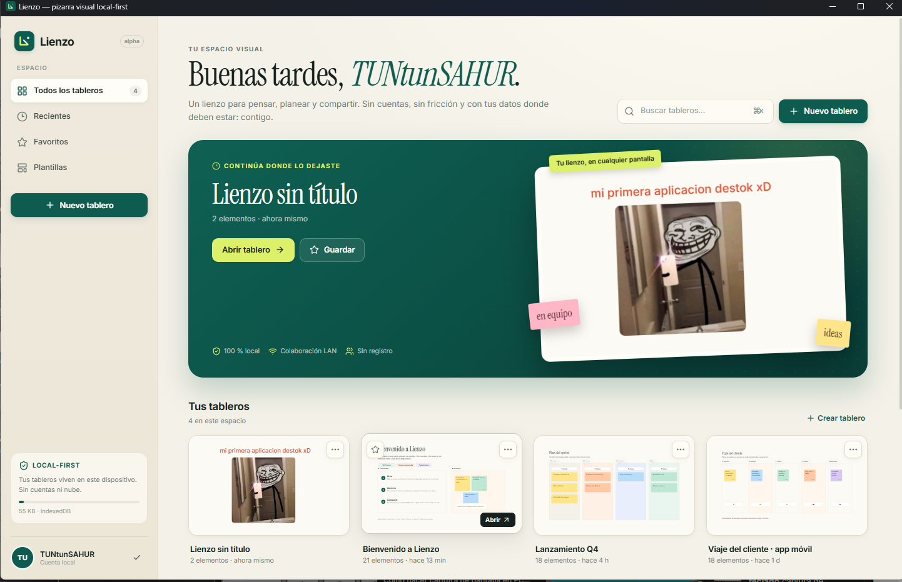

# LIENZO xD 0.1.0-alpha.1

Primera alpha pública de Lienzo, una pizarra visual **local-first** para Windows, web y móvil.

## Descargar

- **Instalador Windows x64:** `Lienzo-Setup-0.1.0-alpha.1.exe`
- **Portable Windows x64:** `Lienzo-0.1.0-alpha.1-portable.exe`

El ejecutable no está firmado. Si Windows muestra “Windows protegió tu PC”:

1. Pulsa **Más información**.
2. Pulsa **Ejecutar de todas formas**.

## Qué incluye

- Lienzo infinito con pan, zoom, atajos y navegación táctil.
- Notas, formas, texto, dibujo, resaltador, imágenes, marcos y conectores.
- Selección múltiple, alineación, distribución, orden Z, bloqueo y duplicación.
- Edición de texto en línea, inspector de estilos y comentarios anclados.
- 9 plantillas: bienvenida, lluvia de ideas, retrospectiva, kanban, mapa mental, flujo, viaje del cliente y plan semanal.
- Presentación por marcos.
- Persistencia local en IndexedDB, exportación PNG/JSON e importación.
- Sala LAN con QR, presencia, cursores y sincronización en tiempo real.
- Aplicación Electron con servidor de sala integrado.
- PWA instalable y proyectos Capacitor Android/iOS.

## Primeros pasos

1. Instala y abre Lienzo.
2. Pulsa **Nuevo tablero** y elige una plantilla.
3. Crea una nota con `N` y haz doble clic para escribir.
4. Pulsa **Compartir** para abrir una sala LAN o exportar.
5. Pulsa **Presentar** para recorrer los marcos.

Guía completa: [`docs/GUIA-USO.md`](docs/GUIA-USO.md).

## Verificación

- `tsc --noEmit` sin errores.
- 14 pruebas unitarias aprobadas.
- E2E real con Playwright/Edge: edición, undo/redo, comentarios, presentación, QR, PNG, PWA y sincronización escritorio ↔ móvil.
- Aplicación empaquetada probada desde una ruta limpia; el servidor integrado arranca en el puerto 8787.
- PWA offline verificada.

## Límites conocidos

- Sin nube, cuentas, IA, integraciones ni permisos enterprise.
- Colaboración **last-write-wins** por objeto; sin CRDT.
- Sala LAN sin autenticación; úsala en redes de confianza.
- Catálogo de 9 plantillas.
- Ejecutable sin firma de código.
- APK/IPA no incluidos; los proyectos nativos están en el repositorio.

## Detalles técnicos

- React 19 + TypeScript + Canvas 2D.
- Vite 8, Zustand, IndexedDB, Node.js + WebSocket, Electron, Capacitor.
- Build Windows con Electron Builder (NSIS + portable).
- Código y documentación: <https://github.com/ismael567-wq/LIENZO-xD>

Hecho para pensar en voz alta, sin pedir permiso a la nube.
